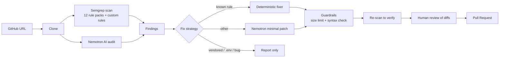
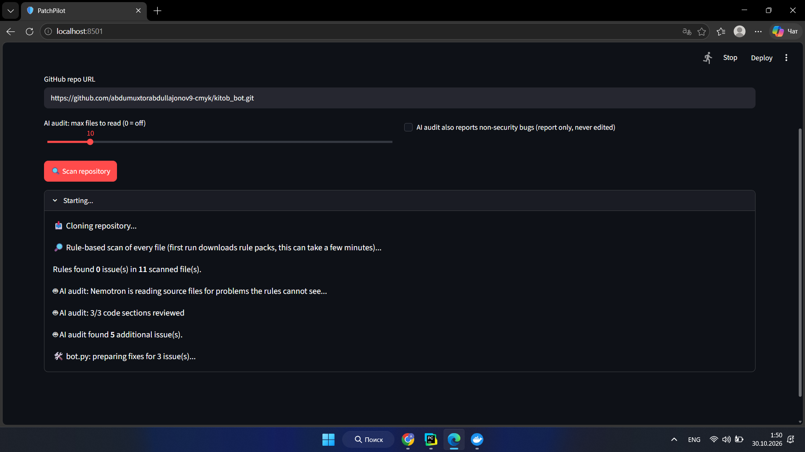
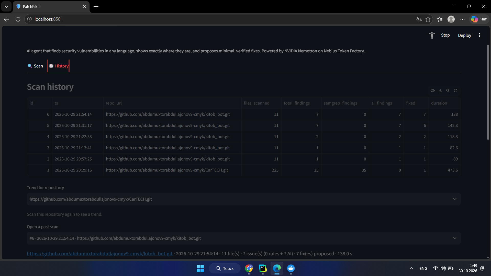
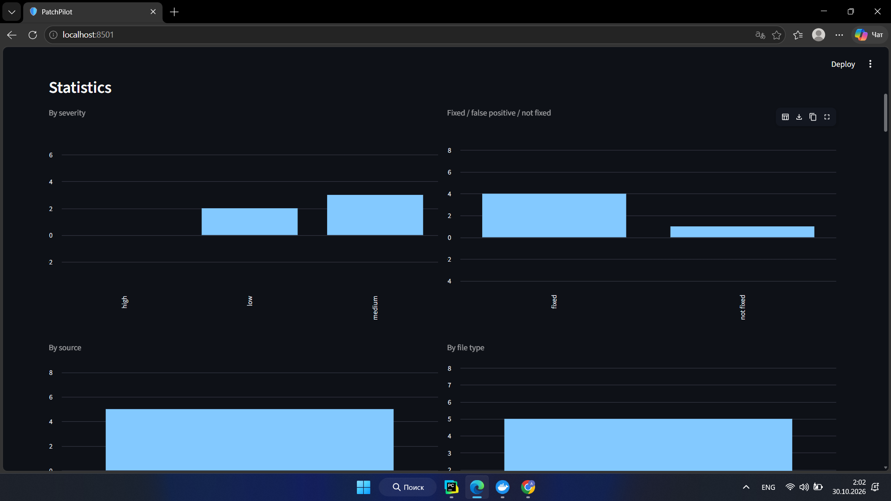

# 🛡️ PatchPilot

**An AI security agent that finds vulnerabilities in any GitHub repository, shows exactly where they are, writes the smallest possible fix, re-scans to verify it, and opens a Pull Request, only after a human approves.**

Powered by **NVIDIA Nemotron** models served through **Nebius Token Factory**.

---

## Why PatchPilot

Static analyzers report problems but leave the fixing to you. LLM "auto-fixers" fix things but often rewrite half of your file and can't prove the result is safe. PatchPilot combines both and keeps a human in control:

| Problem | How PatchPilot handles it |
|---|---|
| Rules miss logic-level issues | A Nemotron **AI audit** reads the source in overlapping chunks and reports what rules cannot see |
| LLM rewrites too much code | The model only sees the lines around the finding. The result is spliced back in, and fixes touching more than **40 lines are rejected** |
| LLM output may break the code | Python/JSON **syntax is checked** before a fix is accepted |
| False trust in AI fixes | Rule findings are **re-scanned with Semgrep**. AI findings are labelled as proposals |
| Fixes that shouldn't be automated | Vendored files, `.env` secrets and non-security bugs are **report-only** |
| Deterministic problems | CSRF tokens and missing SRI hashes are fixed **by code, not by the model** |
| Untrusted repositories | Scanned code is marked as untrusted data in prompts (prompt-injection guard); only `https://github.com/<owner>/<repo>` URLs are accepted |

## Pipeline



## Models

| Task | Model |
|---|---|
| Writing fixes, triage | `nvidia/Nemotron-3-Ultra-550b-a55b` |
| Source-code audit (many parallel calls) | `nvidia/nemotron-3-super-120b-a12b` |

## Quick start

**Requirements:** Python 3.11+, Docker (runs Semgrep), git, a [Nebius Token Factory](https://tokenfactory.nebius.com) API key.

```bash
git clone https://github.com/abdumuxtorabdullajonov9-cmyk/patchpilot
cd patchpilot
pip install -r requirements.txt
cp .env.example .env        # then fill in NEBIUS_API_KEY (and GITHUB_TOKEN for PRs)
docker pull semgrep/semgrep
streamlit run app.py
```

Paste a GitHub repository URL, press **Scan repository**, review every diff, then create the Pull Request.

> The first scan downloads Semgrep rule packs and can take a few minutes. Semgrep `--config=auto` needs internet access.

### Command-line demo

`main.py` runs the original single-file pipeline (scan → triage → fix → verify → PR) on `examples/vulnerable_repo`. `benchmark.py` runs it across the five sample repositories in `examples/`.

## Tests

```bash
python -m unittest discover -s tests -v
```

The tests need no network, Docker or API key. They cover the patch splicing, safety guardrails, deterministic fixers, AI-output parsing, URL validation and scan history.

## Project layout

```
app.py                  Streamlit UI (scan, report, statistics, PR, history)
agents/ai_auditor.py    Nemotron source audit (chunking, confidence filter, re-check)
agents/patcher.py       Minimal-patch engine and guardrails
agents/deterministic_fixes.py   Code-based fixers (CSRF token, SRI hash)
agents/pr_agent.py      One branch, one Pull Request, many files
tools/scanner_tool.py   Semgrep via Docker
tools/sandbox_tool.py   Before/after re-scan comparison
tools/history.py        SQLite scan history
tests/                  Unit tests
```

## Limitations (by design)

- A passing re-scan means the **rule no longer matches**. It does not prove the fix is correct, so the UI asks for a human review before any PR.
- AI-audit findings are proposals. PatchPilot cannot see your templates, URLs or deployment settings.
- Files over 400 KB, non-UTF-8 files and third-party folders are skipped by the AI audit (the rule scan still covers them). The coverage report in the UI lists exactly what was and was not checked.
- Secrets committed to a repository must be **rotated**, not just edited. PatchPilot reports these and does not pretend to fix them.

## Extra safety nets (tools/fix_risks.py)

- A fix is **rejected** if it adds code that makes the project less safe (for example `verify=False`, `eval()`, `shell=True`, `csrf_exempt`) or code that cannot work (Django password validators placed in a field's `validators=[...]` list).
- A fix that makes a Django view POST-only gets a visible warning: template links that use GET must be changed too, otherwise they return 405.
- Third-party / vendored files (`staticfiles/`, `node_modules/`, minified files) are hidden by default in the findings list; one checkbox shows them.

## Demo

- 🎥 Demo video: https://www.youtube.com/watch?v=1w2mlKps9gM
- 🖼️ Screenshots: 

## Built for the NVIDIA hackathon

PatchPilot uses two NVIDIA Nemotron models through Nebius Token Factory: **Nemotron-3-Ultra** writes minimal fixes and triages findings, **Nemotron-3-Super** runs the parallel source audit. Every AI fix passes size, syntax and re-scan guardrails and needs human approval before a Pull Request is created.

## Legacy command-line scripts

`main.py` and `benchmark.py` are the original single-file CLI prototype. They are kept for reference; the Streamlit app (`app.py`) is the main product. `main.py` has a hard-coded target repository and PR path.

## License

MIT, see [LICENSE](LICENSE).
